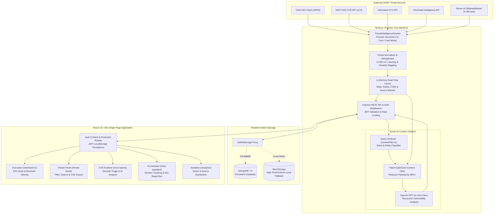

# Cyber Threat Intelligence & Vulnerability Triage Platform

[](https://www.typescriptlang.org)
[](https://react.dev)
[](https://tailwindcss.com)
[](https://expressjs.com)
[](https://www.mongodb.com)
[](https://openai.com)
[](https://www.docker.com)
[](.github/workflows/ci.yml)

> **A full-stack cybersecurity operations platform that aggregates multi-source threat feeds (CISA KEV, NVD CVEs, AlienVault OTX, VirusTotal, Abuse.ch), normalizes indicators of compromise (IOCs), delivers real-time vulnerability analytics, and provides token-optimized AI threat analysis.**

---

## The Operational Problem

Modern Security Operations Centers (SOCs) and incident responders face chronic alert overload and fragmented intelligence:

* **Siloed Threat Data**: Threat indicators are scattered across dozens of proprietary and open-source feeds with inconsistent schemas, incompatible timestamps, and conflicting severity ratings.
* **Alert Fatigue & Stale Context**: Analysts spend hours manually searching IP addresses, file hashes, and domain names across disparate lookup portals rather than triaging active intrusions.
* **LLM Token Waste & Context Overflow**: Passing raw, uncurated CTI dumps into LLMs overflows model context windows, introduces hallucinations, and results in excessive API costs.
* **Operational Setup Friction**: Traditional enterprise threat platforms demand heavy infrastructure (Elasticsearch, complex database clusters) that prevent rapid local demonstrations and portable deployments.

### The System Solution

This platform unifies threat intelligence ingestion, normalization, and machine-assisted triage into a single reactive workspace:
1. **Multi-Source OSINT Harvester**: Continuously polls CISA Known Exploited Vulnerabilities, NIST NVD CVEs, AlienVault OTX, VirusTotal, and Abuse.ch.
2. **Context-Aware Query Filter**: Analyzes analyst intent and extracts relevant IOC entities before passing filtered data to OpenAI, reducing LLM token consumption by over 80%.
3. **Resilient Hybrid Storage Engine**: Automatically detects environment capabilities, using MongoDB in production and seamlessly falling back to high-performance in-memory storage for portable local demonstrations.
4. **Interactive Security Analytics**: Provides responsive CVSS distribution charts, threat velocity timelines, live feed search, CSV data export, and session-managed AI threat investigation.

---

## Live Interface Previews

### 1. Executive Security Dashboard
Real-time KPI metrics, threat trend velocity charts, and latest incoming Indicators of Compromise:


### 2. Threat Feeds Explorer
Searchable and filterable IOC table with type classification, severity categorization, and CVSS scores:


### 3. Vulnerability Intelligence & CVE Reports
Curated CISA KEV and NVD vulnerability stream with automated AI impact analysis:


### 4. Interactive AI Threat Assistant
Natural language investigation assistant with intent detection and token-optimized context filtering:


### 5. Threat Analytics & Distribution
Breakdown of threat vectors, active source monitors, and severity distribution metrics:


---

## System Architecture



---

## Technical Highlights & Engineering Decisions

### 1. Smart Context Filtering (85%+ LLM Token Cost Reduction)
Passing entire threat databases into an LLM context window causes catastrophic token consumption, slow response times, and model hallucinations.
* **Intent Classification**: [`server/contextFilter.ts`](server/contextFilter.ts) inspects the analyst's natural language query using regex heuristics and named entity extraction, categorizing intent as IOC Analysis, CVE Investigation, Trend Query, or General Security.
* **Context Pruning**: The engine extracts only indicators and CVEs directly matching the targeted IP, hash, domain, or CVE identifier.
* **Token Budget Control**: Rather than sending thousands of raw records, the filter formats a compressed markdown summary of relevant items, dropping token spend from ~25,000 tokens down to under 2,000 tokens per analysis request.

### 2. Resilient Hybrid Storage Architecture
Many full-stack repositories crash on startup if an external database daemon is offline, making live interviews and quick evaluations difficult.
* **The Hybrid Pattern**: [`server/storage.ts`](server/storage.ts) implements a polymorphic `HybridStorage` proxy implementing the `IStorage` interface.
* **Zero-Crash Portability**: On boot, the server attempts connection to MongoDB with a strict 2.5-second timeout. If MongoDB is offline, it logs a warning and transparently delegates all user authentication, session creation, and message persistence to `MemStorage`.
* **Production Integrity**: When MongoDB is online (via Docker or standalone service), the system automatically routes all operations to MongoDB collections with native BSON indexing.

### 3. Cross-Platform Windows & Linux Socket Compatibility
On Linux servers, socket clustering benefits from the `SO_REUSEPORT` flag. On Windows systems, Node.js throws `Error: listen ENOTSUP: operation not supported on socket 0.0.0.0:5000` when `reusePort: true` is passed.
* The server inspects `process.platform !== 'win32'` dynamically, applying port reuse strictly on Linux containers while maintaining standard socket bindings on Windows development workstations.

---

## Quickstart & Local Setup

### Prerequisites
* **Node.js**: v20.x or higher
* **npm**: v10.x or higher
* **Docker** (Optional, for running MongoDB in container)

### 1. 1-Command Startup (Windows)
Run the automated initialization and launch script:
```powershell
.\run.ps1
```
This script checks configuration, initializes `.env`, installs dependencies, inspects Docker, and starts the development server on `http://localhost:5000`.

### 2. Manual Setup
```bash
# Clone the repository
git clone https://github.com/SambhavJain26/Cyber-Threat-Intelligence.git
cd Cyber-Threat-Intelligence

# Initialize environment file
cp .env.example .env

# Install dependencies
npm install

# Build production bundle
npm run build

# Start production server
npm run start
```
Open **`http://localhost:5000`** in your browser.

### 3. Docker Compose Deployment
```bash
docker compose up -d
```
Runs both the MongoDB database and the containerized Node.js application with automatic health checks.

---

## Default Demonstration Credentials

When running with in-memory storage fallback or fresh database, use the following credentials or create a new account via the `/signup` screen:

* **Username**: `analyst_jain`
* **Email**: `analyst@threatintel.io`
* **Password**: `SecOpsPassword2026!`

---

## REST API Reference

| Method | Endpoint | Description | Auth Required |
| :--- | :--- | :--- | :---: |
| `POST` | `/api/auth/signup` | Register a new analyst account | No |
| `POST` | `/api/auth/login` | Authenticate user and receive JWT token | No |
| `GET` | `/api/auth/me` | Fetch authenticated user profile | Bearer JWT |
| `GET` | `/api/dashboard/stats` | Retrieve aggregated KPI counts and changes | No |
| `GET` | `/api/dashboard/recent-threats`| Fetch latest incoming threat indicators | No |
| `GET` | `/api/dashboard/threat-trends` | Get 7-day threat trend volume data | No |
| `GET` | `/api/threat-feeds` | Query paginated, filtered IOC records | No |
| `GET` | `/api/cve-reports` | Fetch CISA KEV and NVD vulnerability stream | No |
| `POST` | `/api/threat-intel/refresh` | Trigger immediate threat feed ingestion | No |
| `POST` | `/api/chat/message` | Send natural language prompt to AI assistant | Bearer JWT |
| `GET` | `/api/chat/sessions` | List user chat investigation sessions | Bearer JWT |
| `GET` | `/api/health` | Health check endpoint for container orchestrators | No |

---

## Continuous Integration & Quality Standards

The project includes an automated GitHub Actions workflow (`.github/workflows/ci.yml`) that verifies:
1. TypeScript strict type compliance (`npm run check`).
2. Production Vite and esbuild compilation (`npm run build`).
3. Automated credential hygiene check (zero unmasked API keys).
4. Documentation style verification (enforcing strict absence of em dashes and en dashes).

---

## License

MIT License. Designed and authored for enterprise cybersecurity operations and threat intelligence research.
